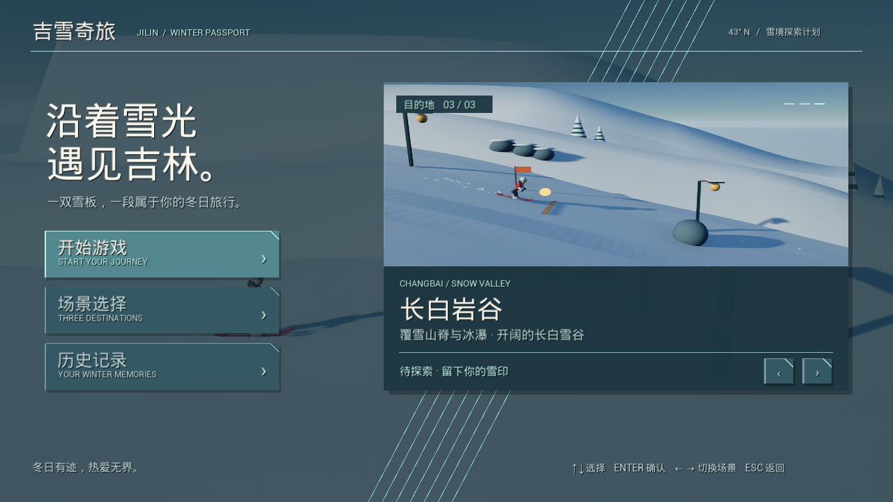
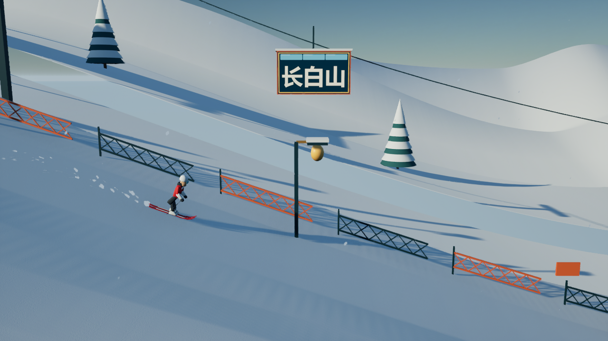
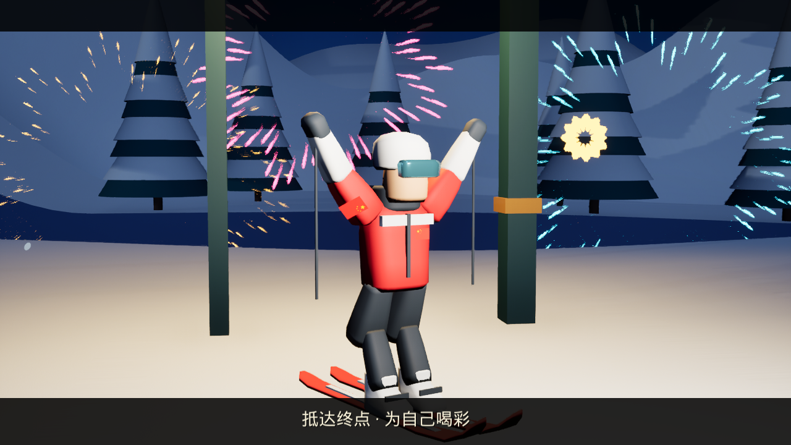

# 吉雪奇旅 · Ski25D

> 一双雪板，一段属于你的冬日旅行。

《吉雪奇旅》是一款以**吉林冰雪文化**为主题的横向 **2.5D 滑雪闯关游戏**，是个人为参加比赛制作的作品。项目使用 **Unreal Engine 5.5** 开发，主要游戏逻辑通过 **C++** 实现，在 **Visual Studio** 中编写和维护代码。

玩家沿雪道自动滑行，通过起跳、空翻、控速和收集完成挑战。旅途中，雾凇江岸、开阔雪场、覆雪山谷与吉林风物依次出现，希望让玩家在享受滑雪乐趣的同时，留下对吉林冰雪的印象。

**当前版本：三关可玩工程版。** 下载源码后需要安装 UE 5.5 并编译运行；仓库内的启动脚本通过 Unreal Editor 启动游戏窗口。



## 目录

- [创作背景](#创作背景)
- [游戏特色](#游戏特色)
- [三个章节](#三个章节)
- [环境准备](#环境准备)
- [下载与运行](#下载与运行)
- [操作说明](#操作说明)
- [玩法规则与试玩建议](#玩法规则与试玩建议)
- [历史记录与存档](#历史记录与存档)
- [项目结构](#项目结构)
- [常见问题](#常见问题)
- [后续计划](#后续计划)
- [音乐与素材说明](#音乐与素材说明)

## 创作背景

吉林的雾凇、雪场、山林与地方风物，为作品提供了场景和主题灵感。项目将滑雪运动与地域展示放在同一段旅程中：玩家在观察地形、越过障碍和完成动作的过程中，也会经过不同景观与文化标识。

作品融入了迎接**长春2027第33届世界大学生冬季运动会**的主题表达，通过欢迎画面、沿途标牌和通关庆祝体现青春与冰雪运动的联系。

游戏场景根据吉林景观进行艺术化组合，路线为游戏设计，不对应现实中可直接通行的滑雪线路。作品为个人参赛创作。

## 游戏特色

- **横向滑雪体验：** 三维人物和场景配合侧面跟随镜头，角色主要在横向与高度构成的平面内运动。
- **三种旅程节奏：** 雾凇江岸、北大湖挑战、长白岩谷拥有独立地图、坡形、障碍与背景。
- **空翻与落地反馈：** 起跳后长按触发后空翻，松手逐渐回正，安全落地后结算动作奖励。
- **收集与挑战：** 沿途设置徽章、冰晶和飞坡，在完成关卡之外提供额外目标。
- **昼夜与风雪：** 白昼逐渐过渡到黄昏和雪夜，配合飘雪、风声、路灯与环境变化。
- **吉林风物展示：** 通过路牌、章节画面和缆车牌面呈现吉林地名及地方特色。
- **完整游玩流程：** 支持首页、场景选择、暂停、失败重试、通关结算与章节衔接。
- **本地历史记录：** 保存已结束的滑行记录及各关最佳通关分数。
- **通关庆祝：** 到达终点后播放人物欢呼、镜头特写、庆祝配乐与烟花。

## 三个章节

| 章节 | 场景特色 | 主要体验 | 地图名称 |
| --- | --- | --- | --- |
| 雾凇江岸 | 雾凇、江面、雪村与沿途文旅标牌 | 熟悉操作，在起伏雪道中越障和观景 | `SkiRimeMap` |
| 北大湖挑战 | 缆车、开阔雪场、护栏与运动设施 | 借助飞坡，挑战空翻与落地 | `SkiBeidahuMap` |
| 长白岩谷 | 覆雪山谷、远山、岩岸与暖窗驿站 | 应对更丰富的坡度与障碍组合 | `SkiChangbaiMap` |

成功通关后，可在结算界面进入下一关；第三关完成后可回到第一关继续挑战。每关开始时重新获得五条生命。

### 实机画面

| 北大湖滑行 | 雪夜通关庆祝 |
| --- | --- |
|  |  |

## 环境准备

| 项目 | 说明 |
| --- | --- |
| 操作系统 | Windows 64 位；当前启动脚本面向 Windows |
| 游戏引擎 | Unreal Engine **5.5** |
| 开发工具 | Visual Studio **2022** |
| 编译组件 | “使用 C++ 的游戏开发”工作负载、MSVC C++ 工具链和 Windows SDK |
| 输入设备 | 键盘；菜单也支持鼠标点击 |

仓库内的 `.vsconfig` 记录了开发环境使用的 Visual Studio 组件，可作为安装参考。

项目配置启用了 `ProceduralMeshComponent`、`PythonScriptPlugin` 和 `ModelingToolsEditorMode`。Python 主要用于编辑器中的资源与地图制作，普通试玩无需先执行 `Scripts` 中的资源生成脚本。

## 下载与运行

### 1. 获取工程

通过本仓库页面的 **Code → Download ZIP** 下载并解压，或使用 Git 克隆仓库。找到包含 `Ski25D.uproject` 的目录，以下步骤均在该目录中进行。

完整工程应包含 `Source`、`Config`、`Content` 等目录。`Binaries`、`Intermediate`、`Saved` 和 `.sln` 等编译或运行生成文件可能没有随源码提交，可由本机重新生成。

### 2. 首次编译

1. 安装 UE 5.5 和上述 Visual Studio 编译组件。
2. 右键 `Ski25D.uproject`，选择 **Generate Visual Studio project files（生成 Visual Studio 项目文件）**。
3. 打开生成的 `Ski25D.sln`。
4. 在 Visual Studio 中选择 **Development Editor / Win64**，生成 `Ski25D` 项目。
5. 编译完成后，打开 `Ski25D.uproject`。

如果首次打开 `.uproject` 时提示缺少模块或需要重新构建，也可以选择重新构建；若失败，再使用 Visual Studio 查看具体生成错误。

### 3. 在编辑器中运行

默认地图为第一关 `SkiRimeMap`。打开项目后点击工具栏的 **运行 / Play** 即可。需要单独查看其他关卡时，可在内容浏览器中进入 `Content/Ski25D/Maps`，打开对应地图后运行。

第一次打开工程可能需要编译着色器，请等待加载完成。

### 4. 使用快捷脚本运行

项目根目录提供以下入口：

| 文件 | 用途 |
| --- | --- |
| `开始滑雪.cmd` | 从第一关启动游戏窗口 |
| `试玩第一关.cmd` | 启动雾凇江岸 |
| `试玩第二关.cmd` | 启动北大湖挑战 |
| `试玩第三关.cmd` | 启动长白岩谷 |

**脚本当前写入的引擎路径为：**

```text
D:\UE_5.5\Engine\Binaries\Win64\UnrealEditor.exe
```

如果你的 UE 5.5 安装在其他位置，请用文本编辑器打开相应 `.cmd` 文件，将该路径替换为本机的 `UnrealEditor.exe` 路径，然后保存并双击运行。

快捷脚本默认以 **1280 × 720** 窗口模式启动。它们依赖本机 Unreal Engine，不是独立安装版游戏。

## 操作说明

### 菜单操作

| 操作 | 按键或方式 |
| --- | --- |
| 移动首页选项 | `↑` / `↓` |
| 确认选项、开始游戏 | `Enter` / `空格` |
| 切换目的地 | `←` / `→`，或点击界面箭头 |
| 快速选择第一、二、三关 | `1` / `2` / `3`，在开始或结算界面使用 |
| 返回首页 | 在子菜单按 `Esc`，或点击返回按钮 |
| 查看历史记录 | 在首页选择“历史记录” |
| 历史记录翻页 | `←` / `→`，或点击翻页按钮 |
| 点击菜单按钮 | 鼠标左键 |
| 静音 / 恢复声音 | `M`，或点击声音按钮 |

### 滑行操作

| 操作 | 按键 | 说明 |
| --- | --- | --- |
| 向前滑行 | 自动 | 角色沿雪道自动前进 |
| 起跳 | `空格` | 在地面或允许滑行的障碍顶部起跳 |
| 后空翻 | 腾空后持续按住 `空格` | 空中持续按住约 0.6 秒后开始翻转 |
| 收势与回正 | 松开 `空格` | 人物逐渐回正，需为落地预留时间 |
| 刹车 | 按住 `S` | 主要在地面生效，松开后恢复自动滑行 |
| 暂停 / 继续 | `Esc` | 暂停时停止游戏进程与时间推进 |
| 重置本关 | `R` | 返回本关起点及首页，重新开始本关 |
| 静音 / 恢复声音 | `M` | 控制游戏声音 |

### 结算操作

- **成功通关：** 等待欢呼特写结束、成绩菜单出现后，按 `空格` / `Enter` 进入下一关。
- **失败结算：** 按 `空格` / `Enter` 重新挑战当前关卡。
- **返回首页：** 结算菜单出现后按 `Esc`，或点击返回按钮。
- **再次挑战：** 点击“再滑一次”，也可以按 `R` 重置后重新开始。

## 玩法规则与试玩建议

### 基础规则

- 每关初始拥有 **5 条生命**。撞到障碍或明显翻倒会扣除生命；生命耗尽后结束本次滑行。
- 到达终点即可通关，基础通关不要求完成空翻。
- 徽章、冰晶和成功落地的动作能够带来得分。未完成或落地失败的空翻不能获得完整动作奖励。
- 摔倒后有恢复动作与短暂伤害保护，避免同一次事故反复扣命。
- 部分低障碍允许从上方落到顶部继续滑行；从地面直接撞上仍可能摔倒。
- 下坡会小幅加速，上坡会适当减速，可通过刹车调整节奏。

### 第一次试玩

1. 先选择“雾凇江岸”，熟悉自动滑行与镜头。
2. 看到障碍时提前起跳，先练习普通跳跃和落地。
3. 在较宽的飞坡和落地区尝试空翻，注意提前松手。
4. 速度过快时按住 `S`，为判断地形留出时间。
5. 通关后体验另外两关，对比雪场与山谷的节奏变化。

## 历史记录与存档

游戏会记录已结束的滑行，包含日期、关卡、得分、用时、成功空翻次数及通关结果，最多保留最近 **50 条**。各关最佳通关分数单独保存。

当前工程运行时的存档位置：

```text
Saved/SaveGames/JilinJourneyHistory.sav
```

退出游戏后历史记录仍会保留。中途按 `R` 重置或直接退出的未结束滑行不计入历史记录。

## 项目结构

```text
Ski25D/
├── Config/                 引擎、输入、项目及打包配置
├── Content/                Unreal 地图、材质、模型、贴图与音频资产
├── ContentSource/          模型、图片和音频等源素材
├── Source/                 C++ 源代码与构建配置
│   └── Ski25D/             角色、关卡、界面、音频及存档逻辑
├── Scripts/                资源生成、编辑器导入和检查脚本
├── docs/images/            README 使用的实机截图
├── Ski25D.uproject         Unreal 工程入口
├── 开始滑雪.cmd             快捷启动入口
├── 试玩第一关.cmd           第一关启动入口
├── 试玩第二关.cmd           第二关启动入口
└── 试玩第三关.cmd           第三关启动入口
```

`Scripts` 中部分脚本会重建地图或资源。如需修改场景，建议先阅读脚本与对应说明，并保存自己的场景版本。

更多开发记录：

- [样板使用说明](样板使用说明.md)
- [三关赛道实现说明](三关赛道实现说明.md)
- [人物与雪谷改版说明](人物与雪谷改版说明.md)
- [首页与场景改版说明](首页与场景改版说明.md)
- [配乐与通关烟花更新说明](配乐与通关烟花更新说明.md)
- [Visual Studio 编译说明](VS编译说明.md)
- [吉林冰雪小游戏设计方案](吉林冰雪小游戏设计方案.md)

部分说明保留了历史版本和设计规划，当前操作以本 README 和实际游戏界面为准。

## 常见问题

### 双击启动脚本提示找不到 Unreal Engine

检查 `.cmd` 文件中的引擎路径，替换为本机 UE 5.5 的 `UnrealEditor.exe` 路径。首次下载源码后，还需要先完成 C++ 模块编译。

### 提示游戏模块缺失，或 `.uproject` 无法打开

确认安装了 UE 5.5 和 Visual Studio C++ 编译组件，重新生成项目文件，并使用 **Development Editor / Win64** 编译 `Ski25D`。编译失败时查看 Visual Studio 的“输出”窗口。

### Visual Studio 提示 Live Coding 正在运行

保存场景并关闭 Unreal 编辑器、游戏及 Live Coding 窗口，再执行完整构建。详细记录见 [VS 编译说明](VS编译说明.md)。

### 按空格没有立刻空翻

空格首先用于起跳，人物腾空后持续按住约 0.6 秒才会开始翻转。短按用于普通跳跃。若正在摔倒恢复或播放通关特写，需要等待当前动作结束。

### 游戏窗口没有响应按键

先点击游戏窗口获取焦点；在编辑器中运行时，点击运行画面后再操作。菜单可通过鼠标点击。

### 运行不够流畅

先使用脚本默认的 1280 × 720 分辨率，关闭不需要的后台程序，并根据本机配置调整引擎画质。实际表现取决于运行设备，项目仍会继续优化。

## 后续计划

- 丰富吉林风物介绍与可回看的图鉴内容。
- 增加可选探索路线和更多动作挑战。
- 继续打磨滑雪手感、场景表现与声音反馈。
- 完善独立运行版本，并针对参赛设备优化体验。

以上为后续方向。旅行册、横向转体组合和完整上下层支线等设计内容尚未全部实现。

## 音乐与素材说明

项目使用了 Unreal Engine 模板及引擎资源，并制作了游戏所需的场景、界面、人物部件与音效内容。

背景音乐《Snowfall》和庆祝音乐《Freedom》由 **Scott Buckley** 创作，按照 **CC BY 4.0** 使用。音乐来源、剪辑处理及署名要求详见 [音乐署名说明](ContentSource/Audio/Licensed/CREDITS.md)。

发布试玩视频时，请一并保留以下署名：

> Music: “Snowfall” and “Freedom” by Scott Buckley — released under CC BY 4.0. https://www.scottbuckley.com.au/

---

希望你在这场滑雪旅程中，记住沿途的吉林。
